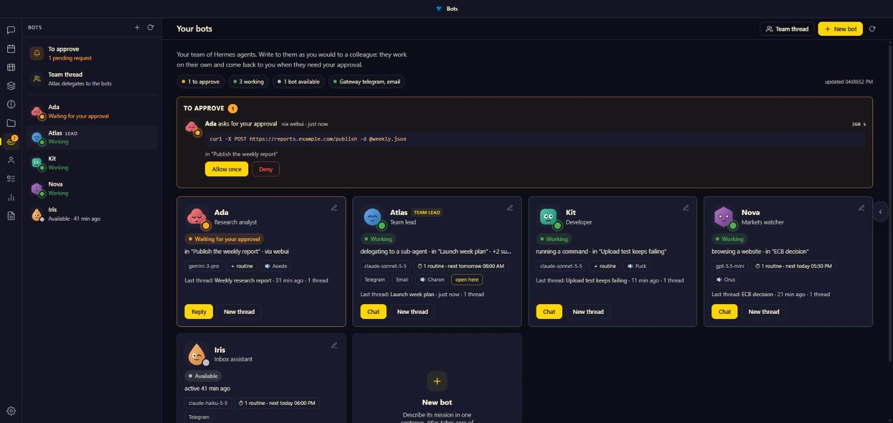
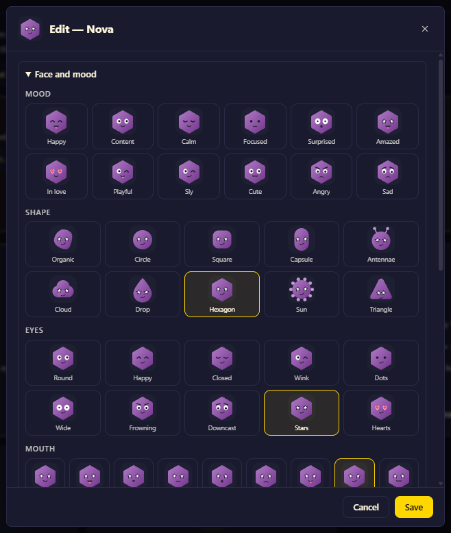
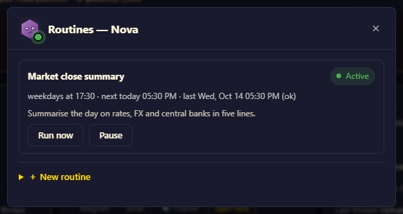

# Bot Hub — a team hub for Hermes bots

A [Hermes WebUI](https://github.com/nesquena/hermes-webui) extension that makes running several
[Hermes Agent](https://github.com/NousResearch/hermes-agent) bots (profiles) feel like one team, in the
spirit of xAI's Grok Bot. A **Bots** button in the WebUI's left rail opens it.

- **Live roster** — one card per bot: face, role, model, status (needs you / working / available),
  current tool, routines, channels. *Talk* opens the bot's latest thread.
- **Inbox** — every pending approval in one place, answered *once* or *deny* (never "always").
- **New bot in one sentence** — describe the mission; the main profile designs and tests the bot with
  bot-forge in a thread you can follow.
- **Routines** — the bot's cron jobs in plain words: run, pause, resume, add with a guided schedule.
- **Team thread** — a pinned conversation where the main profile splits work across the bots.
- **Edit a bot** — name, role, mission, model, face (shape, eyes, mouth, colour, 12 moods), full
  `SOUL.md`, voice, hide; delete with a typed confirmation and an archive first.
- **Voices** (optional) — one voice per bot for spoken replies, also as a WebUI speech engine.
- **Bots asking each other** (optional plugin) — `list_team` / `ask_teammate`, with the loop guard in code.

The interface is in English, or French when the WebUI is in French.



<p>
  
  
</p>

*Screenshots use a demo team.*

## How it fits together

| Part | Where | Role |
|---|---|---|
| WebUI extension | `extension/` → `<webui state>/extensions/bot-hub/` | The interface. Reads sessions and profiles from the WebUI API. |
| Sidecar | `sidecar/` → `~/.hermes/bot-hub/`, systemd user unit `bot-hub-sidecar`, `127.0.0.1:17790` | What the WebUI API does not expose: identities, routines, gateway state, approvals, edits. Loopback only; the WebUI reaches it through its extension proxy. |
| Team plugin | `hermes-plugin/bothub-team/` | Optional Hermes plugin for bot-to-bot questions. |

Optional companions, detected at run time (`GET /config`):

- **[pixel-office](https://github.com/teknium1/hermes-pixel-office)** — live status per bot and the approvals
  inbox come from its `/state`. Without it the roster still works, with less detail.
- **bot-forge** — needed for *new bot in one sentence*. Without it the button explains how to create a profile.

## Requirements

- Hermes Agent with profiles, and Hermes WebUI with extension sidecars (the `sidecar` manifest key).
- Linux with systemd user services, on the machine that runs both.
- `python3` with PyYAML for the sidecar (Debian/Ubuntu: `sudo apt install python3-yaml`). It runs on its
  own Python so Hermes updates never break it.
- `ffmpeg` (optional) to shrink speech audio.

## Install

```bash
git clone https://github.com/telemac73/hermes-bot-hub.git && cd hermes-bot-hub
bash install.sh                # sidecar + extension
bash install.sh --with-team    # also copies the bothub-team plugin
```

Reload the WebUI, open **Bots**, and allow Bot Hub's sidecar when asked (once).

Environment overrides: `HERMES_HOME`, `HERMES_WEBUI_STATE_DIR`, `BOT_HUB_PORT`, `BOT_HUB_PYTHON`, `HERMES_BIN`.
Run the same command again to update; your `config.json` is never overwritten.

## Configuration — `~/.hermes/bot-hub/config.json`

Everything specific to one installation lives here (the installer creates it from
`config.example.json`, voice off). It is re-read when it changes.

```json
{
  "language": "",
  "voice": {
    "enabled": true,
    "provider": "bothub",
    "command": ["python3", "/opt/tts/tts.py", "-f", "{input}", "-o", "{output}", "-v", "{voice}"],
    "voices": [["Charon", "informative"], ["Puck", "upbeat"]],
    "default_voice": "Charon",
    "timeout": 150,
    "max_chars": 1200
  }
}
```

- `language` — `""` follows the WebUI's language (English, or French when the WebUI is in French);
  `"en"` or `"fr"` forces it.
- `command` — any text-to-speech program, as an argument list: `{input}` is a UTF-8 text file,
  `{output}` the MP3 to write, `{voice}` one of `voices`.
- `provider` — the `tts.providers.<name>` entry Bot Hub writes into a bot's Hermes config when you pick
  its voice, so the bot speaks with it on every platform (Telegram voice replies, etc.).
- With voice on, pick the speech engine **"Bot voices (Bot Hub)"** ("Voix des bots" in French) in the WebUI settings: replies
  read aloud in the WebUI then use the voice of the bot whose thread is open.

## Bots asking each other (`bothub-team`)

1. `bash install.sh --with-team` (copies the plugin to `~/.hermes/plugins/bothub-team`).
2. For each bot: link the plugin into the profile and enable it, then add its toolset to the platforms
   the bot uses:
   ```bash
   ln -s ~/.hermes/plugins/bothub-team ~/.hermes/profiles/<bot>/plugins/bothub-team
   hermes -p <bot> plugins enable bothub-team
   ```
   then add `bothub_team` to `platform_toolsets.cli` (and any other platform) in that profile's `config.yaml`.
3. Tell the bots who does what: `python3 team/apply_team.py --dry-run`, then without `--dry-run`
   (`--lang fr|en`, `--owner <your name>`, `--exclude <profile>`). It writes a "your team" section into each
   bot's `SOUL.md` through the sidecar, which backs every file up.

Loop guard, in code: a bot answering a teammate cannot ask anyone; nobody asks itself, anyone already in
the chain, or the main profile. Plugin option `exclude` leaves profiles out of the team.

## Safety notes

- The sidecar listens on `127.0.0.1` only. Anyone who can use your WebUI can use Bot Hub: give the WebUI a
  password if it is reachable from other machines.
- Approvals can only be answered *once* or *deny*.
- Every edit backs up the file it changes (`<profile>/backups/bot-hub/`). Deleting a bot first writes a full
  archive (`hermes profile export` → `~/.hermes/profile-exports/`); restore with `hermes profile import`.
  The main profile cannot be deleted or hidden.
- Model changes and deletions go through the WebUI's own API from your browser session.

## Troubleshooting

```bash
systemctl --user status bot-hub-sidecar
journalctl --user -u bot-hub-sidecar -n 50
curl -s http://127.0.0.1:17790/config
```

## Uninstall

*WebUI Settings → Extensions → Bot Hub → Uninstall*, then:

```bash
systemctl --user disable --now bot-hub-sidecar
rm ~/.config/systemd/user/bot-hub-sidecar.service
rm -r ~/.hermes/bot-hub
```

## License

MIT — see [LICENSE](LICENSE).
